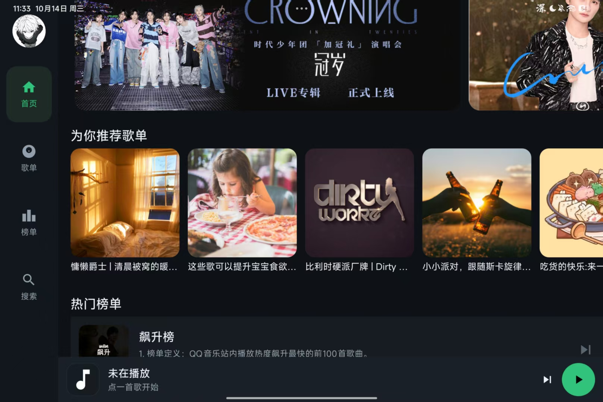
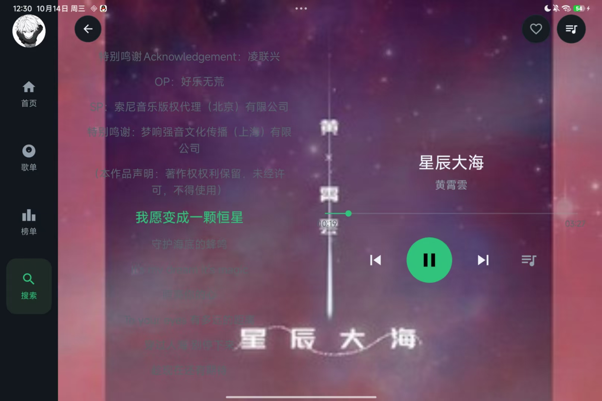
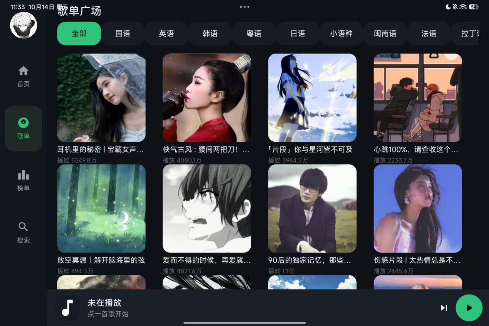
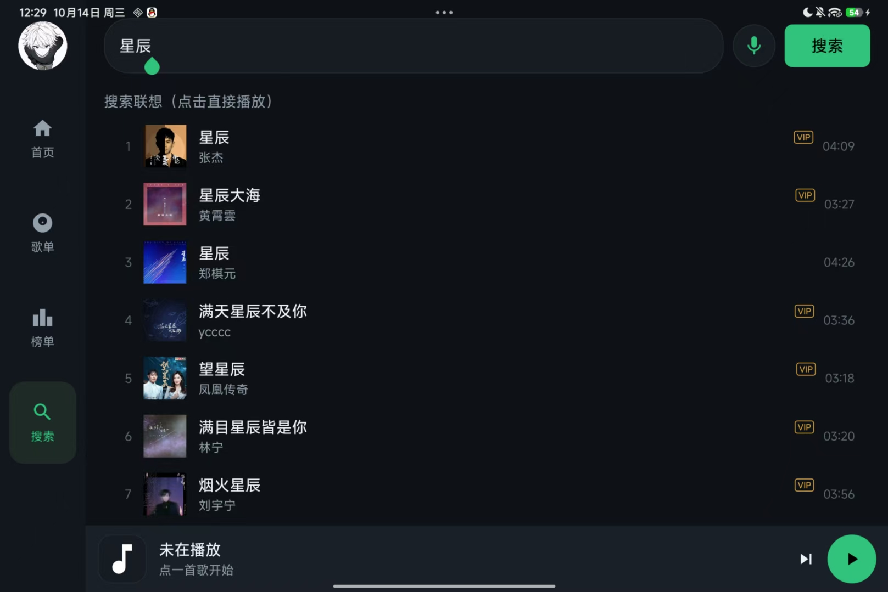
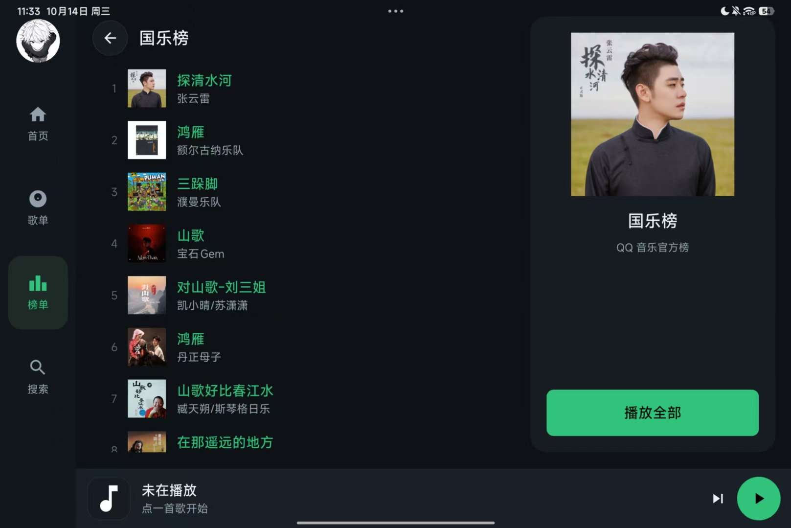
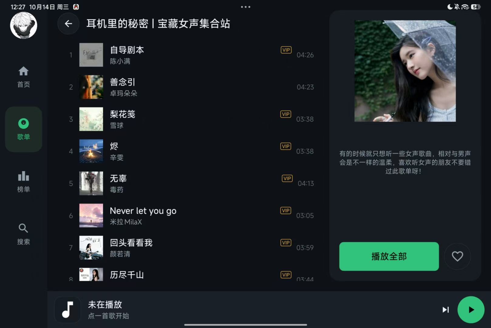

# CarAudioPlayer · 车载风格在线音乐播放器

> Android 客户端（Java + MVVM + LiveData + Room + ExoPlayer）+ 自研 Node.js 中转服务，面向横屏平板 / 车机大屏的在线音乐播放器。仿 QQ 音乐，涵盖首页推荐、歌单广场、排行榜、搜索、在线播放（歌词 / 后台播放）与本地收藏。

| 首页 | 播放页（歌词模式） | 歌单广场 |
| :---: | :---: | :---: |
|  |  |  |

| 搜索联想 | 排行榜详情 | 歌单详情 |
| :---: | :---: | :---: |
|  |  |  |

---

## 一、功能特性

- **首页**：Banner 轮播、为你推荐歌单、热门榜单入口、大家都在搜
- **歌单广场**：分类标签（全部 / 华语 / 欧美 / 日韩…）+ 歌单卡片网格
- **排行榜**：全部榜单列表 + 各榜前三首预览
- **搜索**：热搜词、输入联想（300ms 防抖、带封面）、结果页点击即播
- **播放（全局）**：底部迷你播放条 + 全屏播放页（封面 / 歌词双模式、进度条、收藏、队列面板）+ 后台播放（前台服务 + 媒体通知）
- **我的**：本地头像 / 昵称编辑、我喜欢的歌曲、收藏的歌单

## 二、技术栈

| 层 | 技术 |
| --- | --- |
| Android 客户端 | Java · ViewBinding · MVVM（LiveData）· Room · Media3 / ExoPlayer · OkHttp |
| 中转服务 | Node.js · Koa2 · TypeScript |
| 关键自研组件 | ImageLoader（多级缓存图片加载）· ApiCache（两级缓存 + 分级 TTL + 单飞合并）· 前台服务 + MediaSession 后台播放 |

## 三、系统架构

```
┌──────────────────────┐   HTTP    ┌───────────────────────┐   ┌──────────────┐
│   Android 客户端      │ ────────▶ │   Node 中转服务        │ ─▶│  QQ 音乐上游  │
│  Java + ViewBinding  │  127.0.0.1│   Koa2 + TypeScript    │   │              │
│  MVVM + LiveData     │ ◀──────── │  vkey 签名 / Cookie    │ ◀─│              │
└──────────────────────┘  JSON/音频 └───────────────────────┘   └──────────────┘
          │ 封面图直连 QQ 图床（y.gtimg.cn，公开无鉴权）
          └───────────────────────────────────────────────────────────────▶
```

**为什么需要中转服务**：QQ 音乐的播放地址（vkey）是带登录态的动态签名，客户端无法本地计算；中转服务统一持有 Cookie、处理签名与风控，对外暴露干净的 HTTP 接口。

客户端分层（MVVM）：UI 层（Activity / Fragment，只画界面 + 发导航意图）→ ViewModel 层（网络回调只写 LiveData，不碰 UI）→ Repository / 数据层（ApiCache、Room、QQMusicApi）。

## 四、核心亮点（数据均来自实测）

1. **榜单秒开**：定位「榜单每次必超时（>8s）」根因——原方案对整列表全量解析 songmid，而列表渲染并不需要。改为「展示数据与播放数据分离」：列表去掉 `resolveMid`（0.2s 秒回），播放时再按需解析；服务端对永久映射 `songId→songmid` 加进程内缓存并提升并发。**热歌榜 28.4s → 0.14s，客户端打开榜单由必超时变为 0.2s 秒开。**
2. **自研图片加载组件**（替代 Glide）：内存 LruCache（按可用堆 1/8 计容量）+ 磁盘 50MB LRU + `inJustDecodeBounds` 二次幂降采样 + 裁圆；实测落盘 616 张、封面二次加载 0ms；图片线程池 4→6 后歌单广场 24 张封面加载 **≈8s → 2.5~3s**，快速滚动无明显卡顿。
3. **两级缓存体系**：内存 Map + 磁盘文件，分级 TTL（搜索 10min / 榜单歌单 1h / 歌词 24h），配合单飞合并（ConcurrentHashMap + CompletableFuture）与过期缓存兜底，实现**二次进入任意页面 ≈0ms、网络异常不白屏**。
4. **UI 渲染性能**：`dumpsys gfxinfo` 实测滚动榜单列表 **692 帧仅 1 帧卡顿（卡顿率 0.14%，P99 13ms）**；通过拆分播放状态流（song / playing / progress 三流）+ ListAdapter / DiffUtil 局部刷新降低主线程负担。
5. **稳定性修复**：修复「榜单歌曲点击全部无反应」——中转接口把 query 的字符串 songid 原样透传导致上游返回 500001，且客户端 `PlaybackManager.error()` 无订阅者、错误被静默吞掉；修复类型转换 + 补齐错误链路闭环（消费端 + 自动跳下一首兜底），并用上游 `pay` 字段区分「VIP 产品限制」与「真 Bug」，列表增加 VIP 角标。
6. **内存治理**：12 个 Fragment 在 `onDestroyView` 置空 binding 切断「实例 → 视图树」引用链，订阅统一使用 `getViewLifecycleOwner()`；覆写 `onTrimMemory` 在内存紧张时释放图片缓存；Room 关闭 `allowMainThreadQueries` 强制 DB 不占主线程。

## 五、项目文档

| 文档 | 内容 |
| --- | --- |
| [01-项目技术文档](docs/01-项目技术文档.md) | 双工程架构、技术选型与理由、核心链路 |
| [02-Bug分析报告](docs/02-Bug分析报告.md) | 3 个典型 Bug 的完整排查流程、根因与验证 |
| [03-代码规范自查清单](docs/03-代码规范自查清单.md) | 代码规范自查项 |
| [04-源码阅读清单](docs/04-源码阅读清单.md) | 按文件梳理的阅读路径 |
| [05-全局流程速览](docs/05-全局流程速览.md) | 6 条全局流程（列表加载 / 播放 / 图片 / 收藏 / 歌词 / 导航） |
| [06-性能优化与内存管理](docs/06-性能优化与内存管理.md) | 18 项优化 + 实测数据 + 内存管理 |

## 六、如何运行

**环境要求**：Android Studio、JDK 17、Android SDK（compileSdk 36 / minSdk 24）；中转服务需 Node.js 环境。

1. 启动中转服务（`qq-music-api`），它需要一份有效的 QQ 音乐登录 Cookie，配置于其 `config/user-info.json`。
2. 用 Android Studio 打开本项目，将客户端中的 `BASE_URL` 指向运行中转服务的地址（默认 `127.0.0.1:3200`，真机调试时改为电脑局域网 IP）。
3. 运行 `app` 模块，平板 / 车机横屏效果最佳。

## 七、说明

- 客户端为本项目原创；**中转服务基于开源项目 [qq-music-api](https://github.com/sansenjian/qq-music-api) 二次定制**，在其 `getRanks` / `getSongInfo` 等控制器上做了本项目所需的修改。
- 本项目仅供学习与技术交流，请勿用于商业用途；音乐版权归 QQ 音乐所有。
- 无账号体系：收藏、头像等均为本地存储。
